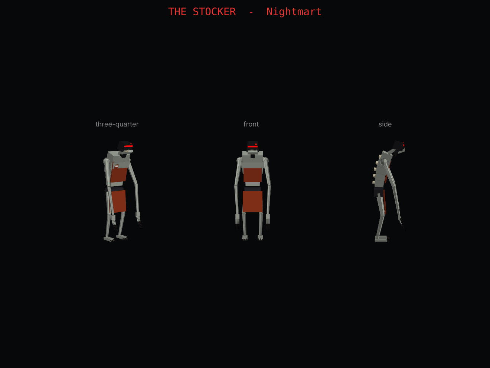

# NIGHTMART: a quiet-shopping horror map for Fortnite (UEFN)

> The store closed an hour ago. The lights are failing. Your list is still in your hand.
> Find everything on it, reach the checkout, and **don't make a sound.**

An original horror game for UEFN. You shop in a dark grocery store while a
monster called **The Stocker** listens for you. It can't see, but it hears very well.
Walking fills your noise meter a little, and sprinting fills it fast. Grabbing the wrong
product or stepping on a trap (a squeaky cart, broken glass, a stack of cans) makes a
sudden loud noise. Once the meter passes the limit, The Stocker runs at you and the lights flicker.
To lose it, crouch and stay still.



## What's in here

| Path | What it is |
|---|---|
| `verse/nightmart_manager.verse` | All the gameplay code: random shopping list, noise meter, monster patrol and chase, catches and lives, flickering lights, win and lose |
| `models/the_stocker.obj` + `.mtl` | The monster's 3D model: low poly, about 2.9 m tall, 8 materials (the red scanner eye is emissive) |
| `models/the_stocker_preview.png` | Preview renders |
| `tools/build_stocker.py` | Script that generates the model. Change the proportions and run it again with `python3 tools/build_stocker.py` (needs `matplotlib` for the preview) |

## The Stocker

A thin night-shift worker who has gone wrong. It has a hunched spine with bones poking
out, arms that hang past its knees and end in claws, and a torn store apron with a name badge.
Where its face should be there is a cracked **barcode scanner** with a red scan-line eye,
and an open jaw full of teeth underneath it.

### Importing it into UEFN
1. Open `models/the_stocker.obj` in **Blender** (free): *File → Import → Wavefront (.obj)*.
2. *File → Export → FBX*. Leave the settings at their defaults. Apply Scalings should be **FBX Units Scale**.
3. In UEFN, drag the `.fbx` into the **Content Browser** and import it as a **Static Mesh**.
4. Open `M_Stocker_eye`. Plug a bright red into **Emissive Color** (multiply it by about 20) so
   the eye glows in the dark.
5. Drag the mesh into the level. In the Details panel, convert it to a **Creative Prop**
   (or put it inside a Prop/Blueprint), so Verse can move it.

> If The Stocker walks sideways or backwards, change **ModelYawOffset** on the device
> (try `90`, `-90` or `180`).

## Building the store (about 1 hour)

```
 ┌──────────────────────────────────────────────┐
 │ FROZEN  │  DAIRY  │  MEAT  │  BAKERY  │ ★P1  │   ★ = patrol point
 ├─────────┴─────────┴────────┴──────────┘      │   ▒ = noise trap
 │  ║ aisle 1 ║ aisle 2 ║ aisle 3 ║ aisle 4 ║   │   $ = checkout
 │  ║  cans ▒ ║ cereal  ║ snacks ▒║ cleaning║★P2│   S = player spawn
 │  ║         ║    ★P4  ║         ║         ║   │
 │ ★P3  ▒ (cart)                         ▒     │
 │   $ $ $                    S  (entrance)    │
 └──────────────────────────────────────────────┘
```

1. **Shell:** use a starter island or a blank one. Build a big room (about 60 × 40 m) and add
   shelving props for 4 to 6 long aisles. Narrow aisles with blind corners are the scariest.
2. **Darkness:** set Island Settings / Day Sequence to night, turn the sun off, add
   **Exponential Height Fog** (set density high), and lower the exposure in a Post Process Volume.
3. **Lights:** place 8 to 15 **Customizable Light** devices as fluorescent ceiling panels. Keep them dim
   with a cold white or green colour, and leave dark gaps between them.
4. **Items:** for each product (about 10 to 15 so the lists change each round):
   - a product prop on the shelf (milk, bread, cereal, eggs and so on)
   - a **Button** device on it, with Interaction Text `Grab Milk` and the interact time at 0.5 s
5. **Checkout:** one **Button** device ("Pay & Leave"). The script keeps it locked until the
   whole list is done.
6. **Traps:** **Trigger** devices on the floor in tight spots. Set them to visible-in-game off and
   Times Can Trigger to unlimited, and put a junk prop on top (cart, glass, cans).
7. **Patrol route:** 4 to 8 small props (turn off Visible In Game) placed down the aisles,
   in loop order.
8. **HUD:** two **HUD Message** devices, one top-left for the shopping list and one
   bottom-centre for the noise meter. Set the display time to 0 (always on).
9. **Audio:** three **Audio Player** devices: chase music (loop), a pickup "rustle", and a
   jumpscare scream.
10. **Endings:** two **End Game** devices, one for the win and one for the loss.

## Hooking up the device

1. Copy `verse/nightmart_manager.verse` into your project's Verse folder
   (*Verse → Verse Explorer → right-click project → Add new Verse file*, then paste it in).
2. Run *Verse → Build Verse Code*.
3. Drag **nightmart_manager** from the Content Browser into the level and fill in its slots:

| Slot | Connect to |
|---|---|
| Items | One entry per product: Name, its Button, its Prop |
| ListSize | How many items are on each round's list (default 5) |
| Checkout | The checkout Button |
| WinGame / LoseGame | The two End Game devices |
| ListHud / NoiseHud | The two HUD Message devices |
| NoiseTraps | All the floor Trigger devices |
| Monster | The Stocker prop |
| PatrolPoints | The patrol markers, in order |
| Lights | All the ceiling lights |
| ChaseMusic / PickupSound / JumpscareSound | The Audio Player devices |

### Recommended island settings
- Players: 1 to 4 (works solo or co-op, and the team shares 3 lives)
- Spawn without items, no pickaxe, no building, fall damage off
- Respawn on, so caught players return to the entrance and the list stays as it was
- First-person camera if your UEFN version supports it, because it is much scarier

## Tuning (all editable on the device)

| Setting | Default | Effect |
|---|---|---|
| HuntThreshold | 70 | Noise level that starts a chase |
| SprintNoisePerSecond | 30 | Sprinting fills the meter in about 3 s |
| WalkNoisePerSecond | 6 | Normal walking slowly builds noise. Crouching is silent |
| NoiseDecayPerSecond | 10 | How fast the meter drains while quiet |
| WrongItemNoise | 35 | Penalty for grabbing an item that is not on the list |
| TrapNoise | 55 | One trap plus a little walking is enough to start a chase |
| SenseRadius | 450 cm | Gets you if you are this close, even when you're quiet (crouching cuts it to 40%) |
| ChaseSpeed | 560 cm/s | Just slower than a sprint |
| ChaseSpeedPerItem | 25 | It gets faster with every item you collect |
| MaxCatches | 3 | Shared lives |

## Known limits and next steps
- The Stocker moves with `creative_prop.MoveTo`, so in a chase it walks **straight at you and
  through shelves**. That makes it feel supernatural, but if you want it to follow the aisles,
  put patrol points at the aisle ends. For true pathfinding, rig the mesh in Blender, import it
  as a Skeletal Mesh, and drive it with an **NPC Spawner** plus a custom NPC Character Definition.
- The noise HUD shows the **loudest** player's meter, which suits co-op where one loud
  player puts everyone at risk. Per-player meters need a Verse UI canvas.
- The Verse was written against the current Fortnite device API but has not been compiled
  outside UEFN. If *Build Verse Code* reports an error, it is most likely a small
  API-signature change, and the error message names the line.
